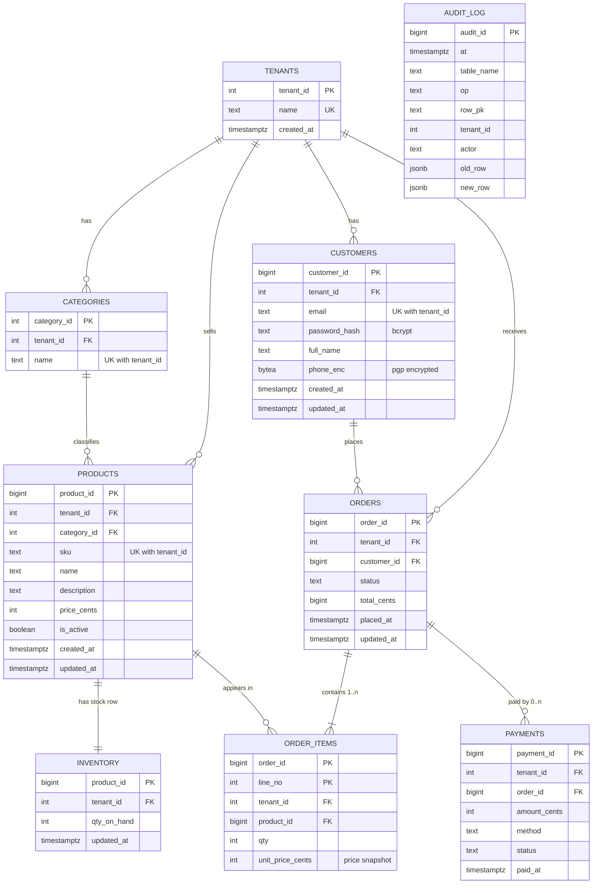

# ER Diagram

`er_diagram.dbml` can be pasted into https://dbdiagram.io for the editable version. Mermaid rendering below (cardinalities are on the relationship lines).

`AUDIT_LOG` has no FKs on purpose: audit rows must outlive the rows they describe.

## Cardinalities
| Relationship | Cardinality | Rule |
|---|---|---|
| Tenant → Customer / Category / Product / Order | 1 : N | each row belongs to exactly one tenant |
| Category → Product | 1 : N | a product has exactly one category |
| Product → Inventory | 1 : 1 | PK = FK on `product_id` |
| Customer → Order | 1 : 0..N | a customer may have no orders yet |
| Order → Order item | 1 : 1..N | ≥1 line enforced by the checkout transaction |
| Product → Order item | 1 : 0..N | resolves the M:N between orders and products |
| Order → Payment | 1 : 0..N | retries / split payments |
